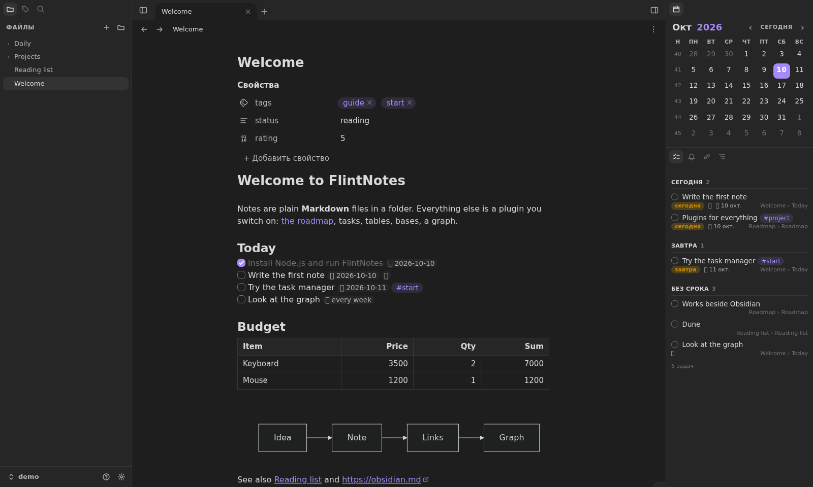
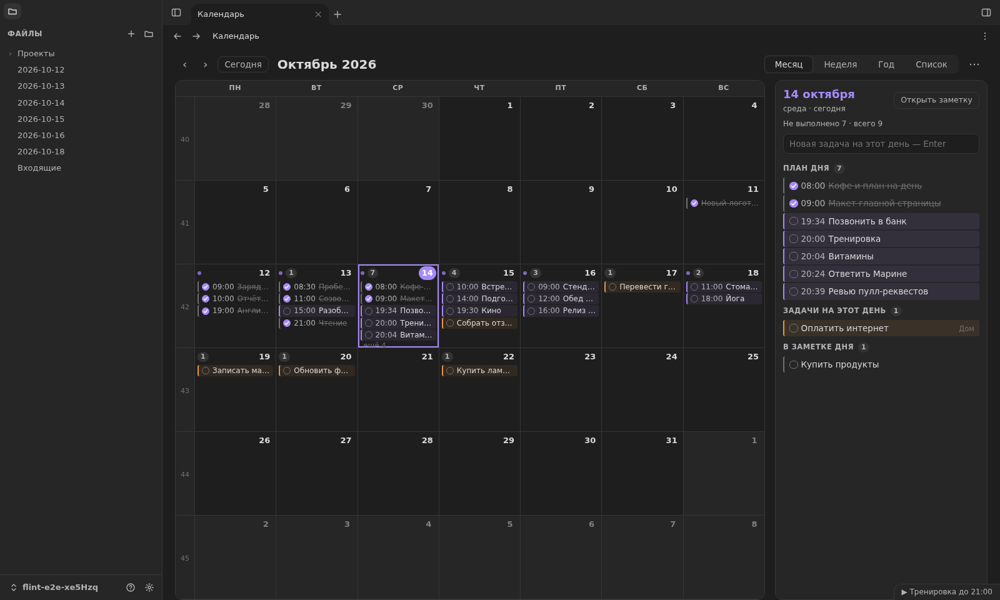
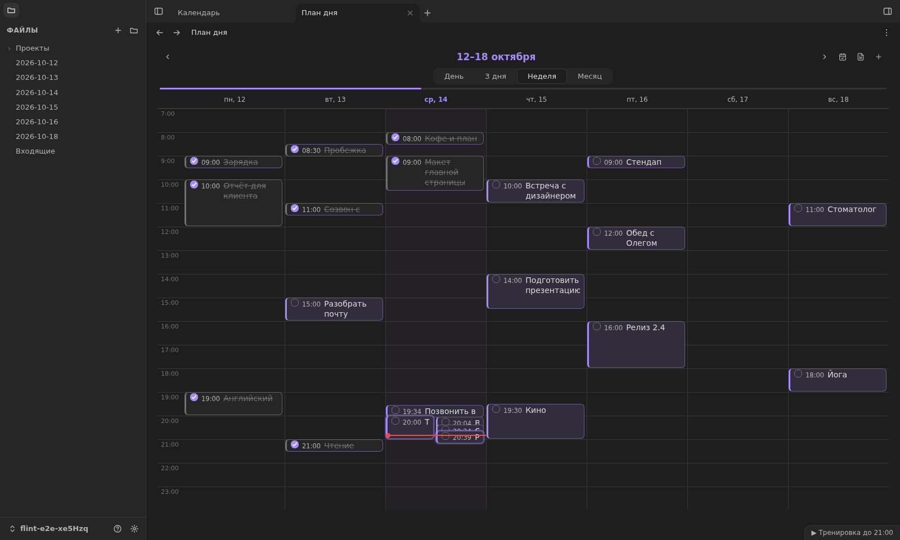
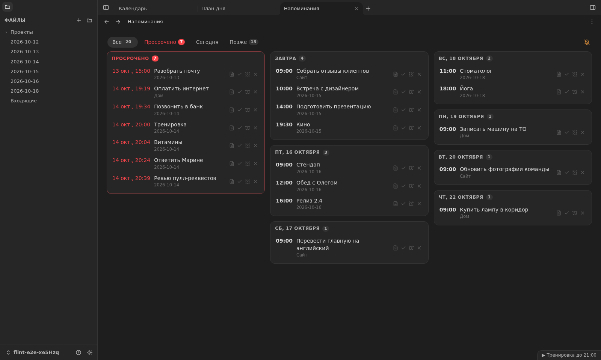
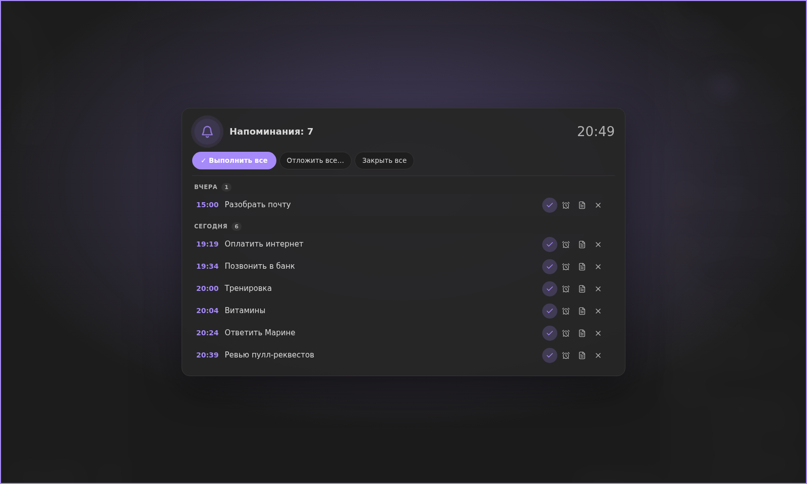

# FlintNotes

Заметки в Markdown: сервер на Linux и лёгкое окно для Windows (или браузер). Хранилище — обычная папка с файлами; всё, кроме редактора и списка файлов, включается плагинами.



## Что умеет

- **Редактор как в Obsidian**: Live Preview, режим чтения (`Ctrl+Shift+E`), свойства, ссылки `[[…]]`, вставки `![[…]]`, таблицы, комментарии `%%…%%`, HTML и внутри строк (`<mark>`, `<kbd>`, `<span style>`), Mermaid. Из режима чтения копируется чистый текст — без скобок ссылок, звёздочек и маркеров списков.
- **Вкладки и панели**: любую панель можно открыть вкладкой на всё окно или перетащить на полосу у края окна — тогда кнопка сама становится этой вкладкой. Вкладки закрепляются и перетаскиваются.
- **Кнопки где угодно**: любую кнопку можно перетащить — вверх или вниз полосы у края окна, на полосу вкладок, над заметкой, в список файлов, в строку состояния — или перенести из её меню («Переместить», «Вернуть на место»). Место запоминается в `.flint/workspace.json`.
- **Задачи, напоминания, план дня, календарь** работают с одними и теми же строками `- [ ]` в формате Obsidian Tasks и Day Planner: своих баз данных нет, всё лежит в заметках.
- **Базы** (`.base`), графики, Dataview, шаблоны Templater, граф, история изменений заметок, поиск по всему хранилищу.
- **Телефон**: на телефоне или планшете в той же сети Wi‑Fi FlintNotes открывается со своим видом — панели выдвигаются пальцем, меню поднимаются снизу, над клавиатурой кнопки правки (см. «С телефона»).
- **Быстрый переход учится**: что выбрано для набранных букв, в следующий раз стоит первым; часто открываемые файлы выше, заметки — выше картинок и архивов с похожим именем.

| | |
| --- | --- |
|  |  |
| **Календарь во вкладке** — месяц, неделя, год или список. Щелчок по дню показывает справа все его дела; задачу и строку плана можно перетащить на другой день. | **План дня** — день, 3 дня, неделя или месяц. Блоки двигаются по времени и на другие дни, щелчок открывает окно блока. |
|  |  |
| **Напоминания** — из `⏰`, `(@2026-10-10 14:00)` и строк плана дня; отложить, закрыть, «не беспокоить». | **Когда напоминаний много** — одно окно со списком по дням и кнопками «Выполнить все», «Отложить все», «Закрыть все». |

## Как это устроено

FlintNotes — это **сервер** и **окно**. Заметки, поиск, указатель, карточки ссылок и всё, что с ними делается, работают на сервере: это служба на Linux (Debian), где лежат и сами хранилища. Приложение для Windows — только окно: оно показывает страницу сервера, а то, что принадлежит самому компьютеру перед глазами, оставляет себе — заголовок-полосу вкладок, трей, запуск вместе с Windows, напоминания уведомлениями и собственные обновления. Страница приходит с сервера, поэтому всегда той же версии, что и он.

Сервер и окно обновляются порознь: сервер — сборкой в этой папке (`npm run release`; служба подхватывает её сама), окно — релизом на GitHub.

## Запуск

### Сервер на Debian

Служба живёт в этой папке: программа — `release/` (её собирает `npm run release`), свои файлы (настройки, кэши, собственные хранилища) — `.service/` рядом, работает она от владельца папки. Всё делает один скрипт на `sh`, `service/flintnotes` (нужны `nodejs` 20 или новее и `systemd`):

```bash
service/flintnotes install /home/name/obsidian   # установить и запустить; папку с заметками можно не указывать
```

Скрипт собирает программу, просит `sudo`, пишет `/etc/systemd/system/flintnotes.service`, запускает службу и печатает ссылку с ключом и QR-код для приложения на Windows. Заметки остаются где лежали, ничего не копируется и не переносится. Прежнюю установку пакетом `.deb` (пакет, пользователь `flintnotes`, `/var/lib/flintnotes`) он при этом убирает.

- **Управление.** `service/flintnotes start | stop | restart | status | logs`; `remove` останавливает службу и убирает её файл (заметки и `.service/` остаются); `unit` только показывает файл службы. Сообщения — в `journalctl -u flintnotes`.
- **Ключи.** `service/flintnotes pair` показывает адрес с ключом: у приложения для Windows свой ключ, у телефонов — свой, который может меньше (`pair --phone`). `--rotate` делает новый ключ и закрывает всё, что было подключено старым.
- **Новая версия сервера** — это сборка в этой папке: `npm run release`. Служба сама видит новый `build.json`, дожидается начатых записей, запускает новый сервер на том же порту, открытые окна перезагружаются сами. Ничего скачивать не нужно.
- **Хранилища.** Какие папки — хранилища, решает владелец, на самом сервере: `flintnotes vault <папка> [--create]` добавляет хранилище (`--create` создаст пустую папку). Окно и телефоны хранилища не добавляют и не забывают: они только переключаются между теми, что есть (меню внизу слева); в окне нет ни выбора папки на сервере, ни кнопки «Забыть». Папки сервера можно перебирать только в браузере на самом Debian (`http://localhost:4600`, «Хранилища»).
- **Напоминания на телефоне, пока страница закрыта.** Страница с напоминаниями работает только открытой, поэтому сервер сам читает заметки (те же правила, что у страницы: ⏰, `(@дата время)`, срок, план дня, тихие часы, «напомнить позже») и кладёт каждое наступившее напоминание в ленту `/api/reminders/stream`; приложение для Android держит одно соединение с этой лентой по домашней сети (без Google и интернета) и показывает уведомления, в том числе пропущенные, пока телефон спал или был вне Wi‑Fi. Что уже просрочено к первому запуску, не отправляется; каждое напоминание уходит один раз. Время в заметках сервер читает по часовому поясу `"timezone": "Europe/Moscow"` из `.service/config.json`, если у Debian другой.
- **Настройки** — по строке в `.service/env` (потом `restart`): `FLINT_BIND=192.168.1.50` — слушать только на этой сетевой карте (иначе слушает на всех, и по Tailscale тоже), `FLINT_POLL=1` — хранилище на сетевом диске, смонтированном в Debian, `HTTPS_PROXY=...` — прокси для карточек ссылок.
- **Obsidian на тех же заметках.** Папку с заметками открывают для Windows по Samba (`[obsidian]` в `/etc/samba/smb.conf`, `force user` — владелец папки): у Obsidian и у FlintNotes одна копия, конфликтовать нечему. Для папки на самом Debian опрос не нужен: служба следит за папками средствами системы (одна точка слежения на папку, а не на файл).
- **Системные команды шаблонов (Templater).** Окно приложения может их запускать, телефон — нет. Список разрешённых команд владелец вписывает вручную в `.service/config.json` (`systemCommands`, по папке хранилища); запрос может назвать только одну из них, придумать свою нельзя. Команды идут на Debian, от имени владельца папки, поэтому пишите их для Linux (`echo "Привет, $name"`, а не `%name%`).
- **Безопасность.** Сеть без шифрования: ключ в ссылке открывает все заметки, поэтому держите службу только в домашней сети и не пересылайте ссылку. С ключом приложения нельзя того, что принадлежит самому серверу: прокси и ключи (одно правило на всё — `server/policy.ts`); хранилища добавляются и забываются только на самом сервере. Неверные ключи считаются: после десяти разных отправитель на минуту получает отказ. Файл службы запрещает ей повышать права, трогать ядро и менять систему вне своих папок.

### Приложение для Windows

Установщик `FlintNotes-Setup-<версия>.exe` — в [релизах на GitHub](https://github.com/jestxfot/FlintNotes/releases). Установка — двойным щелчком: только для текущего пользователя, без прав администратора, в `%LOCALAPPDATA%\Programs\FlintNotes`, с ярлыками в меню «Пуск» и на рабочем столе; удаляется в «Параметры → Приложения». Node.js не нужен. Установщик не подписан, поэтому при первом запуске Windows SmartScreen может предупредить: «Подробнее → Выполнить в любом случае». Для Linux-рабочего стола есть тот же клиент в виде `FlintNotes-<версия>-x86_64.AppImage`.

- **Подключение.** При первом запуске приложение просит ссылку, которую показывает `flintnotes pair`. Адрес и ключ запоминаются (ключ — средствами системы, где они есть; файл `server.json` в папке данных приложения доступен только пользователю); дальше приложение открывается сразу на заметках. Ссылка с неверным ключом, адрес, где слушает не FlintNotes, и служба, которой нет, — каждый случай объясняется словами. Сменить сервер — «Сервер…» в меню значка в трее.
- **Нет связи.** Если сервера нет, приложение показывает свою страницу: какой сервер, почему не вышло и когда следующая попытка (через 2, 4, 8, 16 секунд, потом раз в 30); как только сервер вернётся, окно само откроет заметки. Пока страница заметок открыта, а связь пропала, набранное остаётся в ней и уходит на сервер, когда связь вернётся. Если ключ сменили, приложение просит новую ссылку.
- **Версии.** Приложение и сервер говорят на «протоколе» с номером. Если сервер новее приложения, приложение предложит обновиться; если старее — подскажет собрать сервер заново (`npm run release`).
- **Окно как в Obsidian.** Рамки Windows нет: полоса вкладок — это заголовок окна. Окно двигается за пустое место полосы и верх боковых панелей, двойной щелчок разворачивает его, кнопки «свернуть», «развернуть», «закрыть» — в цветах темы. Размер и место окна запоминаются. `Ctrl+W`, `Ctrl+T`, `Ctrl+Tab` принадлежат приложению, а не браузеру.
- **Трей.** Крестик прячет окно в область уведомлений: напоминания продолжают приходить, щелчок по ним возвращает окно. В меню значка — открыть, новая заметка, палитра команд, сервер, запуск вместе с Windows, журнал работы и «Выйти». Напоминания приходят, пока приложение запущено и страница заметок открыта.
- **Запуск вместе с Windows** — в меню значка или в «Настройки → Программа → Запуск»: приложение стартует свёрнутым в трей.
- В «Настройках» приложения нет ничего, что принадлежит серверу (прокси, ключи, адреса): это делается на самом сервере. Нет и «Показать в проводнике»: папки заметок лежат на сервере.
- Журнал работы приложения — `%APPDATA%\FlintNotes\flintnotes.log` (в Linux — `~/.config/FlintNotes/flintnotes.log`).

**Обновление приложения.** Приложение само смотрит последний релиз на GitHub — вскоре после запуска и раз в 3 часа — и, если версия новее, загружает её в фоне и сверяет контрольную сумму. Затем появляется окно «Доступна новая версия» с кнопками **«Обновить»** и **«Позже»** (если окно спрятано в трей — уведомление и пункт в меню значка). «Обновить» сохраняет набранное, ставит новую версию без окон и запускает приложение снова — таким же, каким оно было: с окном или в трее. «Позже» — новая версия установится сама при следующем запуске. Если Electron в новой версии тот же, приходит только «лёгкое» обновление — собственные файлы окна, несколько мегабайт; иначе — установщик. Одну и ту же версию приложение пробует поставить один раз: если установка не удалась, работает дальше на прежней (причина — в журнале). Выключается это в «Настройки → Программа → Обновление → Обновлять автоматически»; проверить можно кнопкой «Проверить сейчас», командой «Проверить обновления FlintNotes», в меню значка и в окне «О программе».

**Выпуск новой версии окна.** Сборка всегда одна — публичная: в неё не попадает ничего с компьютера, где её собрали; она останавливается, если в неё попали пути этого компьютера или имя и адрес из git. Поднять `version` в `package.json`, `npm run installer` (в WSL, без Windows и Wine) собирает в `publish/` установщик для Windows, AppImage и `latest.json`; всё это — в релиз с тегом `v<версия>`. Установленные приложения найдут его сами. Окно меняется редко: сервер обновляется своей сборкой (`npm run release`), и окно показывает страницу сервера, какой бы версии она ни была.

Окно проверяют `node e2e/desktop-check.mjs` (настоящий Electron: без экрана он работает «вхолостую», с экраном WSLg — как есть; сценарий проверяет подключение по ссылке, неверные ссылки, возврат после остановки сервера, смену ключа, второй запуск и `--quit`, ссылки в браузер и обновление приложения), `node e2e/shell-connection-check.mjs` (разбор ссылки и все ответы сервера, без Electron) и службу — `node e2e/service-check.mjs` (пакет, ключи, права окна и телефона, папки, самообновление и откат).

### Приложение для Android

`android/` — приложение для телефона, такое же окно к серверу, как программа для Windows: страница заметок — сервера, вся работа там. Один раз просит ссылку (`flintnotes pair --phone`: QR-код открывает приложение, ссылку можно вставить), дальше открывается сразу на заметках; если сервера нет — страница «нет связи» с повтором 2→30 с; ссылки на чужие сайты открываются в браузере телефона. Фоновая служба (значок в шторке — «Сменить сервер») держит ленту напоминаний и поднимается после перезагрузки телефона. Шрифт страницы не зависит от «Размера шрифта» телефона. Сборка (JDK 17, Android SDK, Gradle — всё в `~/.local/android`, без root): `android/build.sh` → `publish/FlintNotes-<версия>.apk`; ставится `adb install -r` или файлом с телефона. Подписывается ключом этого компьютера, поэтому новая сборка ставится поверх старой.

### В браузере (разработка и тесты)

Для разработки и тестов FlintNotes работает и в обычном браузере на том же компьютере: `node release/launcher.mjs` держит сервер в фоне, а заметки открываются по адресу `http://localhost:4600` (порт — переменная `FLINT_PORT` или `port` в `~/.flintnotes.json`). Сообщения сервера — в `release/flintnotes.log`. Нужен только [Node.js](https://nodejs.org) 20.19 или новее; ставить зависимости не нужно. На самом сервере браузер с `localhost` может всё, чего нельзя окну и телефону (прокси, ключи, программы шаблонов).

**Сеть.** За карточками ссылок, описаниями видео и т. п. ходит сервер, а не браузер. Если сайты открываются только через прокси, серверу нужно указать его: «Настройки → Программа → Сеть → Прокси» (только в браузере на самом сервере) или `HTTPS_PROXY` в `/etc/default/flintnotes`. Варианты: «Как у компьютера» (`HTTPS_PROXY`), «Без прокси» или свой — HTTP (`http://127.0.0.1:8080`) или SOCKS5 (`socks5://127.0.0.1:1080`, с паролем `socks5://имя:пароль@адрес:порт`). Кнопка «Проверить» показывает, открывается ли `t.me` этим путём.

#### Обновление

Ни перезапускать FlintNotes, ни обновлять страницу вручную не нужно:

1. `npm run release` собирает новую сборку и последним записывает `release/build.json`.
2. Программа запуска (`release/launcher.mjs`) раз в 2 секунды смотрит на этот файл. Увидев новую сборку, она даёт старому серверу дописать начатые сохранения и запускает новый на том же порту. В `release/flintnotes.log` появляется строка «Новая сборка: сервер запущен заново».
3. Открытые страницы узнают от сервера, что он новее, сохраняют набранное и перезагружаются сами — через несколько секунд после конца сборки. Окно для Windows показывает страницу сервера, поэтому делает то же.

Какая сборка у страницы и у сервера и подхватываются ли новые сами, видно в настройках: «Программа → Обновление → Сборка». Весь путь проверяется сценарием `node e2e/update-check.mjs`.

Из исходников, на любой системе:

```bash
npm install
npm run release               # собирает папку release
node release/launcher.mjs     # http://localhost:4600, в фоне и с обновлением; node release/server.mjs — один сервер
```

Адрес говорит, что открыто: `http://localhost:4600/<хранилище>/Папка/Заметка`. Сервер обслуживает все известные хранилища сразу, поэтому в разных вкладках браузера могут быть открыты разные хранилища. Заметки лежат в папке `vault` рядом с программой; другую папку можно открыть в приложении (меню внизу слева → «Управление хранилищами») или при запуске: `node release/launcher.mjs "/home/me/notes"`. Список открывавшихся хранилищ хранится в файле `.flintnotes.json` в домашней папке (у службы — `config.json` в `/var/lib/flintnotes`).

Обычный адрес `localhost` слушает только сам сервер и отклоняет запросы с других сайтов. По сети пускает отдельный порт, и только с ключом.

### С телефона

На сервере: `flintnotes pair --phone` покажет ссылку и QR‑код (порт 4620, как и у окна; в браузере на самом компьютере — «Настройки → Программа → Телефон»). Телефон в той же сети Wi‑Fi открывает её камерой; в меню браузера «Добавить на главный экран» делает из неё значок приложения. В ссылке — ключ телефона: страница меняет его на cookie, без ключа сервер показывает только «Нужен ключ». `flintnotes pair --phone --rotate` выгоняет все телефоны, вошедшие раньше. С телефона нельзя того, что принадлежит серверу (прокси, ключи, программы, обновления), а также открывать новые хранилища, забывать их и смотреть папки сервера. Заметки остаются на сервере: телефон работает, пока он включён.

На узком экране с касанием (телефон, небольшой планшет) у FlintNotes свой вид: сверху имя заметки и её папка, снизу «Назад», поиск, новая заметка, вкладки и «Ещё»; файлы и правая панель выдвигаются кнопкой или движением пальца по заметке вбок; меню (и долгое нажатие) поднимаются листом снизу; пока заметку правят, вместо нижней панели — кнопки над клавиатурой: отменить, задача, список, отступы, ссылка, тег, заголовок, начертания. Свои кнопки туда же — «Быстрые кнопки» → «Над клавиатурой телефона». Вид выбирается на каждом устройстве отдельно: команда «Вид телефона или компьютера на этом устройстве» или `?layout=mobile` / `?layout=desktop` в адресе.

**Кэши.** Чтобы запуск не ждал обхода всего хранилища, сервер держит список его файлов во временной папке системы (`/tmp/FlintNotes`; у службы — `/var/cache/flintnotes`, другая — `FLINT_CACHE`). При запуске он отдаёт этот список сразу, а через мгновение сверяет его с диском в фоне и сообщает страницам, что изменилось. Указатель заметок хранит браузер (IndexedDB) и читает его уже после того, как первая заметка показана. Из памяти без перерисовки возвращаются:

- последние оставленные заметки — с историей отмены;
- посчитанные записи баз;
- картинки хранилища, пока их файл не изменился.

Всё это только кэш: удалить его можно в любой момент, и он соберётся заново.

**Время.** FlintNotes живёт по московскому времени (UTC+3) и не смотрит на часовой пояс Windows или браузера: «сегодня», напоминания, план дня, календарь, шаблоны (`moment()`, `tp.date`), Dataview и часы на домашней вкладке считают по Москве. Для этого `src/core/timezone.ts` первым делом подменяет в странице `Date` и `Intl.DateTimeFormat`; мгновение времени (`Date.now()`, строки с `Z` или смещением) остаётся настоящим. Время в `release/flintnotes.log` тоже московское. Другой пояс — константы в начале этого файла (и `timeZone` в `server/launcher.ts`).

## Плагины

Включаются в настройках (`Ctrl+,` → «Плагины»), по умолчанию все выключены. Встроенные лежат в `src/plugins/<имя>/`, свои можно положить в `<хранилище>/.flint/plugins/` (пример: `examples/plugins/hello-world`).

**Новая заметка.** Самостоятельный конструктор тематических заметок без скриптов (`src/plugins/new-note/`). Включите плагин «Новая заметка»: `Alt+N`, кнопка «+» и создание в списке файлов откроют окно выбора тематики. Есть начальные шаблоны «Видео на YouTube», «Реакция на YouTube», «Еда / рецепт» и обычная заметка. В форме заполняются обязательные поля, выбираются теги из хранилища, меняется папка; предпросмотр показывает текст и окончательное имя файла. Отмена не создаёт файл.

В настройках плагина или командой «Новая заметка: конструктор шаблонов» можно создавать, копировать и удалять шаблоны, задавать категории, папки, имена файлов, теги и разделы. Поля поддерживают текст, многострочный текст, URL, ссылку на заметку, число, дату, выбор из списка, флажок и список тегов. Каждое поле можно сделать обязательным, записать в свойства заметки или использовать только в тексте. Автоматические поля скрыты в форме и заполняются значением по умолчанию. Переменные названия, даты, времени и полей вставляются кнопками конструктора; например, `{{date:YYYY/MM}}` в папке и `{{date}} — {{title}}` в имени. Сохранение сразу добавляет команду для шаблона — ей можно назначить горячую клавишу или кнопку. `Alt+Shift+N` открывает форму независимо от настройки перехвата `Alt+N`.

Библиотека хранится в `.flint/settings.json`, в разделе `new-note.library` с версией формата. Заметки сохраняются как обычные Markdown-файлы с YAML-свойствами. Плагин работает самостоятельно, без плагина «Шаблоны» и настроек Obsidian. Если старый плагин включён, он не заполняет готовую форму повторно. Создание по несуществующей ссылке и через переключатель можно отдельно подключить к форме в настройках.

Блоки в заметках пишутся в тех же форматах, что и в плагинах Obsidian, поэтому одно хранилище открывается в обоих:

| Блок | Плагин здесь | Формат плагина Obsidian |
| --- | --- | --- |
| ```` ```dataview ````, ```` ```dataviewjs ````, `` `= выражение` ``, `ключ:: значение` | Dataview | Dataview |
| ```` ```tasks ```` | Задачи | Tasks (плюс `# view calendar` — месяц вместо списка) |
| ```` ```embed ```` | Карточки ссылок | Link Embed |
| ```` ```widgets ```` | Виджеты в заметках | Widgets |
| ```` ```button ```` | Кнопки | Buttons |
| ```` ```tabs ```` | Вкладки в заметках | Markdown Tabs |
| `<% ... %>`, `<%+ ... %>` | Шаблоны | Templater |
| ```` ```chart ````, `window.renderChart` | Графики | Charts |
| значки и цвета файлов, папок, тегов, свойств | Значки и цвета | Iconic (тот же `data.json` в папке настроек Obsidian) |
| свои значки (PNG и JPG превращаются в SVG) | Значки и цвета | Add Custom Icons (SVG в `custom-icons` в папке настроек Obsidian) |
| менеджер задач (вкладка со списками, календарём и карточкой задачи) | Задачи | те же строки `- [ ]` в формате Obsidian Tasks; своих данных у менеджера нет |
| план дня: строки `- [ ] 17:00 - 17:10 …` в заметке дня | План дня (шкала времени), Задачи (напоминания) | Day Planner (те же строки и имена настроек) |
| ```` ```tracker ```` | Трекер | Tracker |
| заметки папок, ```` ```folder-overview ```` | Заметки папок | Folder notes (те же имена настроек, берутся из его `data.json`) |
| ```` ```mermaid ```` | Диаграммы Mermaid | встроено в Obsidian (та же библиотека Mermaid) |
| блок HTML (`<div>…</div>` на своих строках) | ядро | встроено в Obsidian; скрипты и обработчики `on…` вырезаются |
| HTML внутри строки (`<mark>`, `<u>`, `<kbd>`, `<sub>`, `<span style>`, `<font color>`, `<br>`) | ядро | встроено в Obsidian; остальные теги остаются текстом |
| календарь во вкладке, перенос задач между днями | Календарь | дата пишется в то же поле (`📅`, `⏳`, `🛫`), строка заметки дня переезжает в заметку другого дня |
| свои значки приложения `flint-*` | Значки и цвета | при выборе кладутся SVG-файлом в `custom-icons`, чтобы их видел и Obsidian |
| свои кнопки и макросы | Быстрые кнопки и команды | Commander (формат его `data.json`, файл `.flint/commander.json`) |
| настройки графа | Граф | `graph.json` Obsidian (те же имена, хранятся в `.flint/workspace.json`) |

## Правила для плагинов

Эти правила обязательны для ядра и для каждого плагина, встроенного и стороннего.

1. **Плагин — одна папка.** Всё, что относится к возможности, лежит в `src/plugins/<имя>/` и обращается к ядру только через `src/api.ts`. Выключенный плагин не оставляет следов: всё, что он добавил методами класса `Plugin`, убирается само.
2. **Каждое действие — команда.** Открыть вид или панель, создать, вставить, переключить, перейти — всё регистрируется через `addCommand`. Кнопки, пункты меню и сочетания клавиш вызывают команду, а не дублируют её код. Только команду можно запустить из палитры (`Ctrl+P`), назначить на свои клавиши (Настройки → Сочетания клавиш) и привязать к своей кнопке (плагин «Быстрые кнопки и команды»). Действие без команды пользователю недоступно. Панели (`addPanel`) и вставка блоков (`addInsertCommand`) регистрируют свои команды сами; включение и выключение каждого плагина — тоже команда.
   Команда говорит, к чему она относится, полем `scope`, а место ей находит ядро: `note` — действие с открытой заметкой (меню «⋮» над заметкой), `insert` — вставка в заметку (список «Вставить» того же меню), `vault` — действие с хранилищем, `sidebar` — с боковыми панелями. Плагин не рисует пункты меню сам: он объявляет команду, остальное делает ядро. То же со списком файлов: плагин отвечает ядру, какие записи скрыть, как их пометить и что делает щелчок по папке (`app.explorer`), а рисует список ядро.
3. **Текст — источник правды.** Блок рисуется из текста заметки и пишет изменения обратно в текст (`ctx.setSource`).
4. **Форматы не выдумываются.** Если у Obsidian или его плагина уже есть формат блока или файла данных, используется он же, чтобы одно хранилище открывалось в обоих приложениях. Формат берётся из кода самого плагина.

## Разработка

```bash
npm run dev      # http://localhost:5173, правки видны сразу
npm run check    # проверка типов
npm run release  # готовая сборка в папке release
npm test         # сборка и браузерные тесты (нужен `npx playwright install chromium`)
FLINT_DOCS=docs node e2e/run.mjs 99   # заново снять картинки для README из выдуманного хранилища
FLINT_E2E_FRESH=1 npm test             # все тесты заново, без кэша
```

Тесты помнят, что прошло (`node_modules/.cache/flint-e2e.json`). Сюита, которая прошла, пропускается, пока не изменилось ничего из того, от чего она зависит:

- её собственный файл, запускатель тестов и тестовые файлы;
- код сервера и `public/`;
- сегодняшняя дата;
- файлы сборки, которые страница загрузила за время сюиты (ядро и только её плагины).

Правка одного плагина запускает заново только сюиты с этим плагином, правка ядра — все.

- `server/` — файловый API и слежение за диском
- `src/core/` — ядро: хранилище, индекс заметок, редактор, вкладки, настройки, плагины, московское время (`timezone.ts`)
- `src/api.ts` — всё, что доступно плагинам
- `src/plugins/` — по папке на функцию
- `e2e/` — тесты
