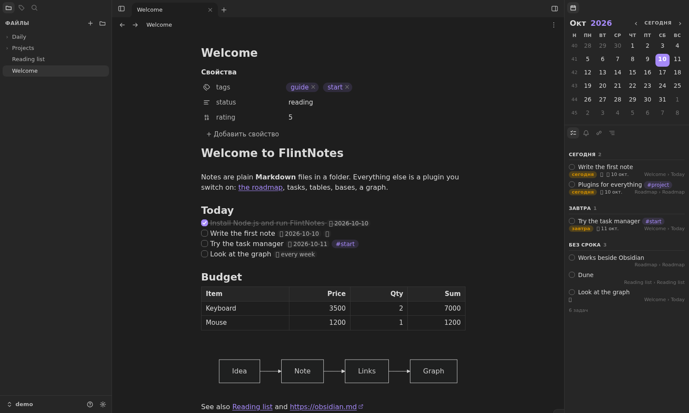
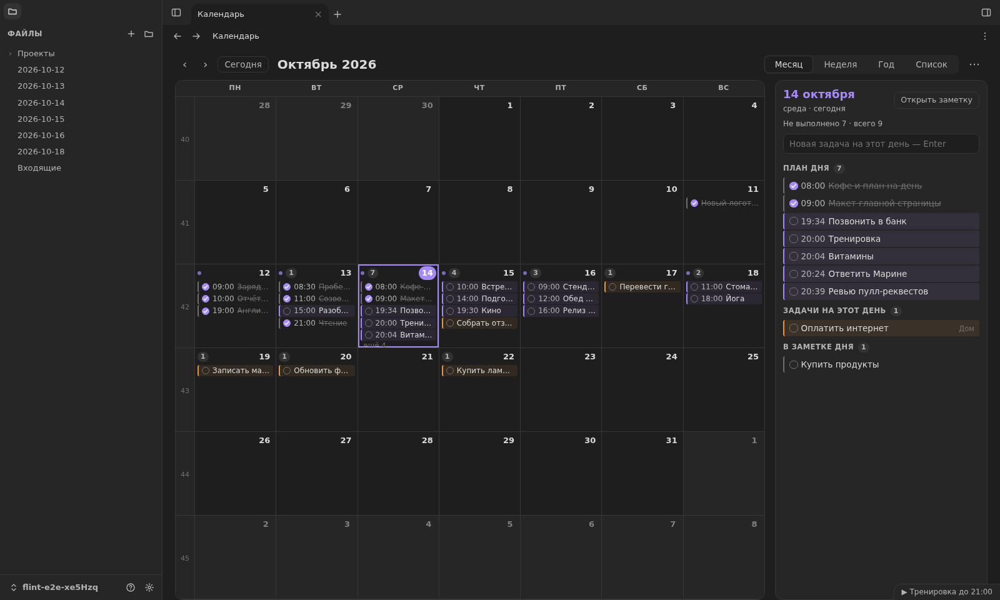
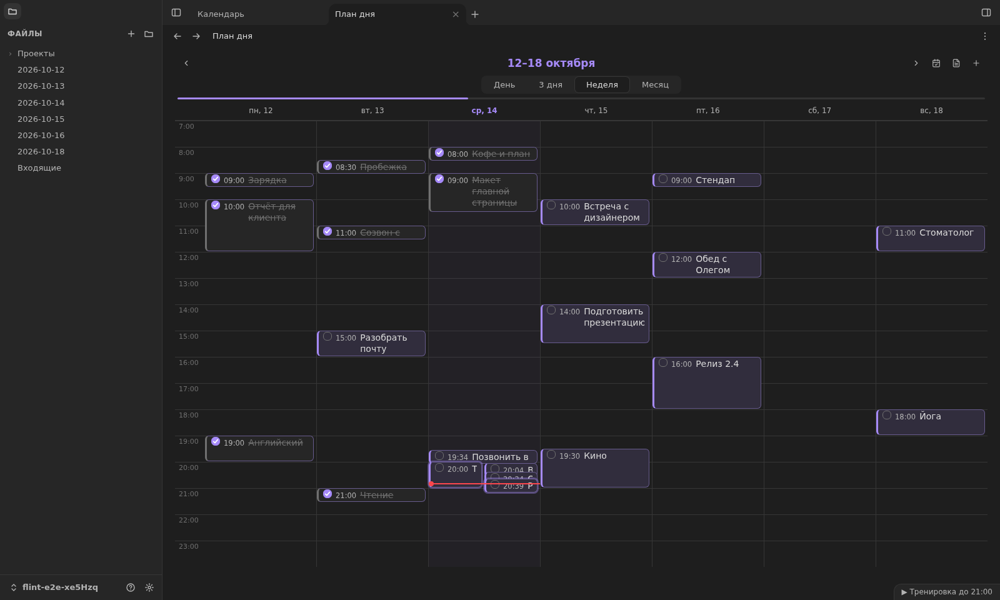
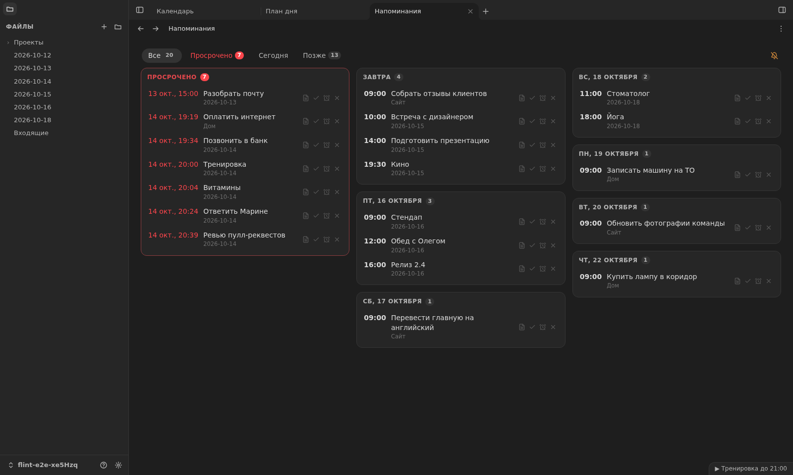
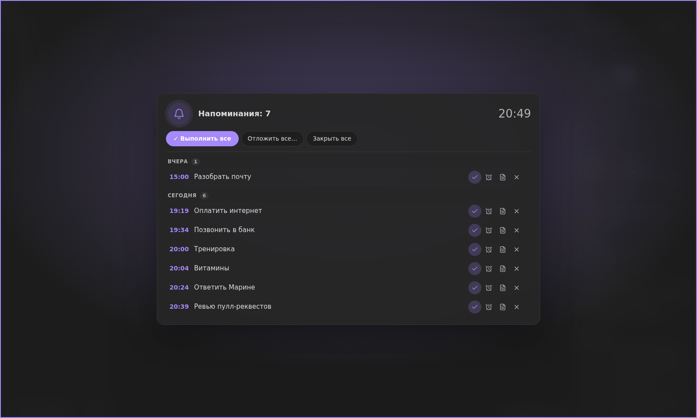

# FlintNotes

Заметки в Markdown — отдельным приложением для Windows или прямо в браузере. Хранилище — обычная папка с файлами; всё, кроме редактора и списка файлов, включается плагинами.



## Что умеет

- **Редактор как в Obsidian**: Live Preview, режим чтения (`Ctrl+Shift+E`), свойства, ссылки `[[…]]`, вставки `![[…]]`, таблицы, комментарии `%%…%%`, HTML и внутри строк (`<mark>`, `<kbd>`, `<span style>`), Mermaid. Из режима чтения копируется чистый текст — без скобок ссылок, звёздочек и маркеров списков.
- **Вкладки и панели**: любую панель можно открыть вкладкой на всё окно или перетащить на полосу у края окна — тогда кнопка сама становится этой вкладкой. Вкладки закрепляются и перетаскиваются.
- **Задачи, напоминания, план дня, календарь** работают с одними и теми же строками `- [ ]` в формате Obsidian Tasks и Day Planner: своих баз данных нет, всё лежит в заметках.
- **Базы** (`.base`), графики, Dataview, шаблоны Templater, граф, история изменений заметок, поиск по всему хранилищу.

| | |
| --- | --- |
|  |  |
| **Календарь во вкладке** — месяц, неделя, год или список. Щелчок по дню показывает справа все его дела; задачу и строку плана можно перетащить на другой день. | **План дня** — день, 3 дня, неделя или месяц. Блоки двигаются по времени и на другие дни, щелчок открывает окно блока. |
|  |  |
| **Напоминания** — из `⏰`, `(@2026-10-10 14:00)` и строк плана дня; отложить, закрыть, «не беспокоить». | **Когда напоминаний много** — одно окно со списком по дням и кнопками «Выполнить все», «Отложить все», «Закрыть все». |

## Запуск

### Приложение для Windows и Linux

Всё — в [релизах на GitHub](https://github.com/jestxfot/FlintNotes/releases). **Linux:** `FlintNotes-<версия>-x86_64.AppImage` — один файл: сделайте его исполняемым (`chmod +x`) и запустите. **Windows:** установщик `FlintNotes-Setup-<версия>.exe`. Установка — двойным щелчком: только для текущего пользователя, без прав администратора, в `%LOCALAPPDATA%\Programs\FlintNotes`, с ярлыками в меню «Пуск» и на рабочем столе; удаляется в «Параметры → Приложения». Node.js не нужен: приложение — это Electron со своим Node внутри. Заметки установщик не трогает. Установщик не подписан, поэтому при первом запуске Windows SmartScreen может предупредить: «Подробнее → Выполнить в любом случае».

- **Окно как в Obsidian.** Рамки Windows нет: полоса вкладок — это заголовок окна. Окно двигается за пустое место полосы и верх боковых панелей, двойной щелчок разворачивает его, кнопки «свернуть», «развернуть», «закрыть» — в цветах темы. Размер и место окна запоминаются. `Ctrl+W`, `Ctrl+T`, `Ctrl+Tab` принадлежат приложению, а не браузеру.
- **Без порта.** Сервер — часть приложения: окно говорит с ним через именованный канал Windows, из браузера и из сети к нему не подключиться. Настройки порта и адресов хранилищ в приложении нет.
- **Трей.** Крестик прячет окно в область уведомлений: напоминания продолжают приходить, щелчок по ним возвращает окно. В меню значка — открыть, новая заметка, палитра команд, запуск вместе с Windows, журнал работы и «Выйти» (как и команда «Выйти из FlintNotes» в палитре).
- **Запуск вместе с Windows** — в меню значка или в «Настройки → Программа → Запуск»: приложение стартует свёрнутым в трей.
- **Браузерная версия рядом.** При запуске приложение останавливает фоновый сервер браузерной версии (`release/launcher.mjs`), если он работает: два FlintNotes на одних хранилищах мешали бы друг другу.
- **Песочница.** Пока своё хранилище не открыто, приложение открывает песочницу — хранилище с примерами, где можно пробовать что угодно: при каждом запуске она возвращается к исходному виду, как в Obsidian. Своё хранилище (любую папку, хоть ту же, что у Obsidian) открывают в меню внизу слева → «Управление хранилищами»; песочница остаётся в списке. Её образец — `desktop/sandbox`.
- Журнал работы приложения и его сервера — `%APPDATA%\FlintNotes\flintnotes.log` (в Linux — `~/.config/FlintNotes/flintnotes.log`).

**Обновление.** Приложение само смотрит последний релиз на GitHub — вскоре после запуска и раз в 3 часа — и, если версия новее, загружает её в фоне и сверяет контрольную сумму. Затем появляется окно «Доступна новая версия» с кнопками **«Обновить»** и **«Позже»** (если окно приложения спрятано в трей — уведомление и пункт в меню значка). «Обновить» сохраняет набранное, ставит новую версию без окон и запускает приложение снова — таким же, каким оно было: с окном или в трее. «Позже» — новая версия установится сама при следующем запуске (например, после перезагрузки), без вопросов. На Windows обновляет установщик, в Linux новый AppImage встаёт на место старого. Одну и ту же версию приложение пробует поставить один раз: если установка не удалась, работает дальше на прежней (причина — в журнале).

Выключается это в «Настройки → Программа → Обновление → Обновлять автоматически»: тогда приложение само ничего не загружает и не ставит, а проверить можно кнопкой «Проверить сейчас» или командой «Проверить обновления FlintNotes».

**Выпуск новой версии.** Сборка всегда одна — публичная: приложение внутри работает на своей копии сборки и ничего не берёт с компьютера, где его собрали; сборка останавливается, если в неё попали пути этого компьютера или имя и адрес из git.

1. Поднять `version` в `package.json` (приложения обновляются только на большую версию).
2. `npm run installer` (в WSL, без Windows и Wine): собирает в `publish/` установщик для Windows, AppImage для Linux и `latest.json`.
3. Выложить все три файла в новый релиз на GitHub с тегом `v<версия>` — установленные приложения сами его найдут.

Всё это проверяет `node e2e/desktop-check.mjs`: Electron для Linux запускается в WSL (нужен экран WSLg и GTK 3 — см. начало файла), а сценарий проверяет, что порта нет, набранное сохраняется, изменения извне видны, новая сборка подхватывается, второй запуск и `--quit` работают, ссылки уходят в браузер, а обновление из релиза ставится само и только один раз.

### В браузере

Для разработки и тестов FlintNotes работает и в обычном браузере: `node release/launcher.mjs` держит сервер в фоне, а заметки открываются по адресу `http://localhost:4600` (порт меняется в настройках, раздел «Программа → Запуск», и запоминается). Сообщения сервера — в `release/flintnotes.log`. Нужен только [Node.js](https://nodejs.org) 20.19 или новее; ставить зависимости не нужно. Вместе с приложением для Windows браузерную версию не запускайте: при старте приложение её останавливает.

**Сеть.** За карточками ссылок, описаниями видео и т. п. ходит сервер, а не браузер. Если браузер открывает сайт через VPN-расширение или свой прокси, серверу нужно указать тот же путь: «Настройки → Программа → Сеть → Прокси». Варианты: «Как у компьютера» (прокси из настроек Windows или `HTTPS_PROXY`), «Без прокси» или свой — HTTP (`http://127.0.0.1:8080`) или SOCKS5 (`socks5://127.0.0.1:1080`, с паролем `socks5://имя:пароль@адрес:порт`). Действует сразу; кнопка «Проверить» показывает, открывается ли `t.me` этим путём.

#### Обновление

Ни перезапускать FlintNotes, ни обновлять страницу вручную не нужно:

1. `npm run release` собирает новую сборку и последним записывает `release/build.json`.
2. Программа запуска (`release/launcher.mjs`) раз в 2 секунды смотрит на этот файл. Увидев новую сборку, она даёт старому серверу дописать начатые сохранения и запускает новый на том же порту. В `release/flintnotes.log` появляется строка «Новая сборка: сервер запущен заново».
3. Открытые страницы узнают от сервера, что он новее, сохраняют набранное и перезагружаются сами — через несколько секунд после конца сборки.

Какая сборка у страницы и у сервера и подхватываются ли новые сами, видно в настройках: «Программа → Обновление → Сборка». Если там написано «Сервер запущен без программы запуска», сервер был запущен напрямую (`node release/server.mjs`) и новую сборку не подхватит: запустите его через `node release/launcher.mjs`.

Весь путь проверяется сценарием `node e2e/update-check.mjs`: он собирает две сборки во временную папку, держит открытую страницу с несохранённым текстом и проверяет, что сервер заменён, страница перезагрузилась сама, текст сохранён, а настройки показывают новую сборку.

Упавший сервер программа запуска тоже запускает снова. Остановить FlintNotes — командой «Остановить FlintNotes» в палитре (`Ctrl+P`).

Из исходников, на любой системе:

```bash
npm install
npm run release               # собирает папку release
node release/launcher.mjs     # http://localhost:4600, в фоне и с обновлением; node release/server.mjs — один сервер
```

Адрес говорит, что открыто: `http://localhost:4600/<хранилище>/Папка/Заметка`. Сервер обслуживает все известные хранилища сразу, поэтому в разных вкладках браузера могут быть открыты разные хранилища.

Заметки лежат в папке `vault` рядом с приложением. Открыть другую папку можно прямо в приложении (меню внизу слева → «Управление хранилищами») или при запуске:

```bash
node release/launcher.mjs "D:/Мои заметки"
```

Список открывавшихся хранилищ хранится в файле `.flintnotes.json` в домашней папке пользователя.

Приложение работает только на этом компьютере: сервер слушает `127.0.0.1` и отклоняет запросы с других сайтов.

**Кэши.** Чтобы запуск не ждал обхода всего хранилища, сервер держит список его файлов во временной папке системы (`%TEMP%\FlintNotes`, другая — `FLINT_CACHE`). При запуске он отдаёт этот список сразу, а через мгновение сверяет его с диском в фоне и сообщает страницам, что изменилось. Указатель заметок хранит браузер (IndexedDB) и читает его уже после того, как первая заметка показана. Из памяти без перерисовки возвращаются:

- последние оставленные заметки — с историей отмены;
- посчитанные записи баз;
- картинки хранилища, пока их файл не изменился.

Всё это только кэш: удалить его можно в любой момент, и он соберётся заново.

**Время.** FlintNotes живёт по московскому времени (UTC+3) и не смотрит на часовой пояс Windows или браузера: «сегодня», напоминания, план дня, календарь, шаблоны (`moment()`, `tp.date`), Dataview и часы на домашней вкладке считают по Москве. Для этого `src/core/timezone.ts` первым делом подменяет в странице `Date` и `Intl.DateTimeFormat`; мгновение времени (`Date.now()`, строки с `Z` или смещением) остаётся настоящим. Время в `release/flintnotes.log` тоже московское. Другой пояс — константы в начале этого файла (и `timeZone` в `server/launcher.ts`).

## Плагины

Включаются в настройках (`Ctrl+,` → «Плагины»), по умолчанию все выключены. Встроенные лежат в `src/plugins/<имя>/`, свои можно положить в `<хранилище>/.flint/plugins/` (пример: `examples/plugins/hello-world`).

Блоки в заметках пишутся в тех же форматах, что и в плагинах Obsidian, поэтому одно хранилище открывается в обоих:

| Блок | Плагин здесь | Формат плагина Obsidian |
| --- | --- | --- |
| ```` ```dataview ````, ```` ```dataviewjs ````, `` `= выражение` ``, `ключ:: значение` | Dataview | Dataview |
| ```` ```tasks ```` | Задачи | Tasks (плюс `# view calendar` — месяц вместо списка) |
| ```` ```embed ```` | Карточки ссылок | Link Embed |
| ```` ```widgets ```` | Виджеты в заметках | Widgets |
| ```` ```button ```` | Кнопки | Buttons |
| ```` ```tabs ```` | Вкладки в заметках | Markdown Tabs |
| `<% ... %>`, `<%+ ... %>` | Шаблоны | Templater |
| ```` ```chart ````, `window.renderChart` | Графики | Charts |
| значки и цвета файлов, папок, тегов, свойств | Значки и цвета | Iconic (тот же `data.json` в папке настроек Obsidian) |
| свои значки (PNG и JPG превращаются в SVG) | Значки и цвета | Add Custom Icons (SVG в `custom-icons` в папке настроек Obsidian) |
| менеджер задач (вкладка со списками, календарём и карточкой задачи) | Задачи | те же строки `- [ ]` в формате Obsidian Tasks; своих данных у менеджера нет |
| план дня: строки `- [ ] 17:00 - 17:10 …` в заметке дня | План дня (шкала времени), Задачи (напоминания) | Day Planner (те же строки и имена настроек) |
| ```` ```tracker ```` | Трекер | Tracker |
| заметки папок, ```` ```folder-overview ```` | Заметки папок | Folder notes (те же имена настроек, берутся из его `data.json`) |
| ```` ```mermaid ```` | Диаграммы Mermaid | встроено в Obsidian (та же библиотека Mermaid) |
| блок HTML (`<div>…</div>` на своих строках) | ядро | встроено в Obsidian; скрипты и обработчики `on…` вырезаются |
| HTML внутри строки (`<mark>`, `<u>`, `<kbd>`, `<sub>`, `<span style>`, `<font color>`, `<br>`) | ядро | встроено в Obsidian; остальные теги остаются текстом |
| календарь во вкладке, перенос задач между днями | Календарь | дата пишется в то же поле (`📅`, `⏳`, `🛫`), строка заметки дня переезжает в заметку другого дня |
| свои значки приложения `flint-*` | Значки и цвета | при выборе кладутся SVG-файлом в `custom-icons`, чтобы их видел и Obsidian |
| свои кнопки и макросы | Быстрые кнопки и команды | Commander (формат его `data.json`, файл `.flint/commander.json`) |
| настройки графа | Граф | `graph.json` Obsidian (те же имена, хранятся в `.flint/workspace.json`) |

## Правила для плагинов

Эти правила обязательны для ядра и для каждого плагина, встроенного и стороннего.

1. **Плагин — одна папка.** Всё, что относится к возможности, лежит в `src/plugins/<имя>/` и обращается к ядру только через `src/api.ts`. Выключенный плагин не оставляет следов: всё, что он добавил методами класса `Plugin`, убирается само.
2. **Каждое действие — команда.** Открыть вид или панель, создать, вставить, переключить, перейти — всё регистрируется через `addCommand`. Кнопки, пункты меню и сочетания клавиш вызывают команду, а не дублируют её код. Только команду можно запустить из палитры (`Ctrl+P`), назначить на свои клавиши (Настройки → Сочетания клавиш) и привязать к своей кнопке (плагин «Быстрые кнопки и команды»). Действие без команды пользователю недоступно. Панели (`addPanel`) и вставка блоков (`addInsertCommand`) регистрируют свои команды сами; включение и выключение каждого плагина — тоже команда.
   Команда говорит, к чему она относится, полем `scope`, а место ей находит ядро: `note` — действие с открытой заметкой (меню «⋮» над заметкой), `insert` — вставка в заметку (список «Вставить» того же меню), `vault` — действие с хранилищем, `sidebar` — с боковыми панелями. Плагин не рисует пункты меню сам: он объявляет команду, остальное делает ядро. То же со списком файлов: плагин отвечает ядру, какие записи скрыть, как их пометить и что делает щелчок по папке (`app.explorer`), а рисует список ядро.
3. **Текст — источник правды.** Блок рисуется из текста заметки и пишет изменения обратно в текст (`ctx.setSource`).
4. **Форматы не выдумываются.** Если у Obsidian или его плагина уже есть формат блока или файла данных, используется он же, чтобы одно хранилище открывалось в обоих приложениях. Формат берётся из кода самого плагина.

## Разработка

```bash
npm run dev      # http://localhost:5173, правки видны сразу
npm run check    # проверка типов
npm run release  # готовая сборка в папке release
npm test         # сборка и браузерные тесты (нужен `npx playwright install chromium`)
FLINT_DOCS=docs node e2e/run.mjs 99   # заново снять картинки для README из выдуманного хранилища
```

- `server/` — файловый API и слежение за диском
- `src/core/` — ядро: хранилище, индекс заметок, редактор, вкладки, настройки, плагины, московское время (`timezone.ts`)
- `src/api.ts` — всё, что доступно плагинам
- `src/plugins/` — по папке на функцию
- `e2e/` — тесты
