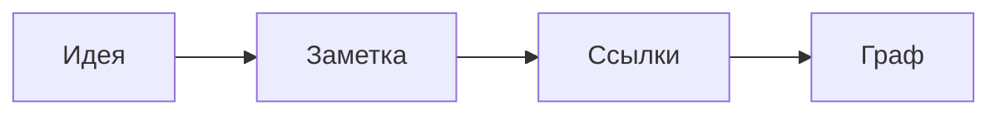

# Таблицы и схемы

## Таблица

Таблица редактируется прямо на месте: щёлкните в ячейку.

| Товар      | Цена | Кол-во | Сумма |
| ---------- | ---: | -----: | ----: |
| Клавиатура | 3500 |      2 |  7000 |
| Мышь       | 1200 |      1 |  1200 |

## Схема

## Выноска

> [!tip] Совет
> Выноски Obsidian работают так же: `> [!note]`, `> [!warning]` и другие.
